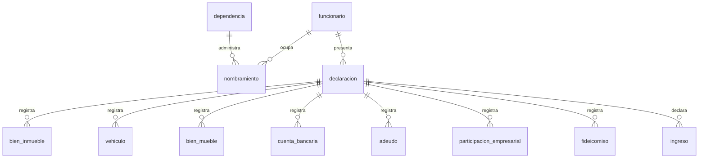

# 🏛️ DECLARANET-UMSNH · Base de Datos de Declaraciones Patrimoniales


> Arquitectura de base de datos en **PostgreSQL** para la gestión del ciclo de vida completo
> de las **declaraciones patrimoniales** del personal de la
> **Universidad Michoacana de San Nicolás de Hidalgo (UMSNH)**: captura, historización,
> validación, auditoría y consulta de declaraciones **iniciales**, **anuales de modificación
> patrimonial** y **de conclusión**.

## 📖 ¿Qué es este repositorio?

Este repositorio contiene **exclusivamente el diseño de la capa de datos** de una plataforma de
declaraciones patrimoniales de servidores públicos, inspirada en los lineamientos del sistema
federal **DECLARANET** y adaptada al contexto institucional de la UMSNH:

- **Modelo de datos** conceptual y lógico, con diagramas entidad-relación.
- **DDL por capas** (`sql/`): base, catálogos, tablas, restricciones, índices, funciones,
  vistas y políticas de seguridad.
- **Migraciones versionadas** en SQL puro (`migraciones/`).
- **Seguridad a nivel de base de datos**: Row-Level Security (RLS), cifrado con `pgcrypto`
  y auditoría automática por triggers.
- **Suite de verificación** en SQL (`pruebas/`).

## ⚖️ Marco normativo que condiciona el diseño

| Norma | Implicación en el modelo de datos |
|---|---|
| **LGRA**, arts. 32–47 | La plataforma modela **5 tipos de trámite**: **INICIO**, **MODIFICACIÓN** y **CONCLUSIÓN** (LGRA), más **NOTA ACLARATORIA** y **CAMBIO DE DEPENDENCIA** (trámites internos UMSNH). |
| **LGRA**, contenido | Secciones: ingresos, bienes inmuebles, vehículos, bienes muebles, inversiones y cuentas, adeudos y pasivos, participación en empresas y fideicomisos. |
| **LGPDPPSO** | Datos personales sensibles: minimización, cifrado, acceso por roles y bitácora de consultas. |

## 🐘 ¿Por qué PostgreSQL?

| Criterio | PostgreSQL | MySQL / MariaDB |
|---|---|---|
| Row-Level Security (RLS) | ✅ Nativo y maduro | ❌ No disponible |
| Cifrado por columna | ✅ `pgcrypto` incluido | ⚠️ Limitado a la capa de aplicación |
| JSONB + índices GIN | ✅ Excelente | ⚠️ JSON menos potente |
| Constraints avanzados | ✅ CHECK complejos, deferrables, EXCLUDE | ⚠️ Limitado |
| Particionamiento declarativo | ✅ Sí | ⚠️ Limitado |
| Licenciamiento | PostgreSQL License (tipo BSD) | GPL / propiedad de Oracle |

Para datos patrimoniales de servidores públicos, **RLS + `pgcrypto` + auditoría JSONB**
son capacidades decisivas y justifican la elección del motor.

## 🗂️ Modelo de datos

### Esquemas por módulo

| Esquema | Módulo | Contenido |
|---|---|---|
| `patrimonial` | Núcleo y declaraciones | `funcionario`, `nombramiento`, `dependencia`, `declaracion` y anexos |
| `catalogos` | Catálogos | tipos de declaración, tipos de bien, monedas, parentescos, niveles de estudio… |
| `seguridad` | Seguridad | usuarios de aplicación, roles y permisos |
| `auditoria` | Auditoría | bitácoras de cambios y de consultas |

### Diagrama ER simplificado

Diagrama de alto nivel (el modelo completo y detallado vivirá en `docs/`):



> 🔒 **Regla de historización**: una declaración presentada **nunca se modifica**; cada cambio
> genera una nueva versión y toda transición de estado
> (`borrador → presentada → en_revision → validada / rechazada`) la valida la propia
> base de datos.

### Sección de usuarios (implementada)

Ya existen en la base las tablas `patrimonial.funcionario` y `seguridad.administrador`
(completamente separadas), `seguridad.token_usuario` (recuperación de contraseña y
verificación de correo) y la bitácora `auditoria.registro_evento`.
Detalle en [`docs/modelo-conceptual.md`](docs/modelo-conceptual.md).

## 📁 Estructura del repositorio

```
base-de-datos-declaranet/
├── AGENTS.md                  # Convenciones y reglas del proyecto (obligatorio antes de tocar SQL)
├── CONTEXT.md                 # 📍 Punto de partida: estado, decisiones y siguiente paso
├── README.md
├── docker-compose.yml         # PostgreSQL 16 para desarrollo local
├── .env.example               # Plantilla de variables de entorno
├── opencode.jsonc             # Config OpenCode: auto-carga de CONTEXT.md en cada sesión
├── docs/
│   ├── erd/                  # Diagramas entidad-relación
│   └── adr/                  # Decisiones de arquitectura (ADR-NNN-*.md)
├── sql/                      # Referencia de DDL por capas (fuente de verdad: migraciones/)
│   ├── 00_base/              # Extensiones, esquemas, roles, dominios de datos
│   ├── 10_catalogos/         # Catálogos / listas de valores
│   ├── 20_tablas/            # DDL por módulo funcional
│   ├── 30_restricciones/     # FKs, CHECKs, UNIQUEs
│   ├── 40_indices/           # Índices secundarios
│   ├── 50_funciones/         # Funciones y triggers (auditoría, folios, estados)
│   ├── 60_vistas/            # Vistas de consulta y reportes
│   ├── 70_politicas/         # Políticas Row-Level Security
│   └── 80_semillas/          # Datos iniciales (catálogos, roles)
├── migraciones/              # Scripts versionados: NNNN_descripcion.sql
└── pruebas/                  # Verificaciones / asserts SQL
```

## 🚀 Puesta en marcha (desarrollo local)

Requisitos: Docker y Docker Compose.

```bash
# 1. Clonar
git clone https://github.com/LeoAlonso01/base-de-datos-declaranet.git
cd base-de-datos-declaranet

# 2. Variables de entorno (solo desarrollo local)
cp .env.example .env

# 3. Levantar PostgreSQL 16
docker compose up -d

# 4. Conectarse a la base de datos
docker compose exec db psql -U declaranet -d declaranet
```

> ⚠️ Las credenciales de `.env.example` son **únicamente para desarrollo local**.
> En producción se gestionan por secretos, nunca commiteados.

## 🔄 Migraciones

- Una migración por cambio lógico: `migraciones/NNNN_descripcion.sql`.
- **Nunca** se edita una migración ya aplicada; se crea una nueva.
- Cada migración es transaccional (`BEGIN; ... COMMIT;`) y debe funcionar sobre una
  base recién creada **y** sobre una ya migrada.
- Aplicación y verificación: `psql "$DATABASE_URL" -f migraciones/NNNN_*.sql`
  seguida de los scripts de `pruebas/`.

## 🗺️ Estado y hoja de ruta

**Estado actual: 🚧 en fase de diseño (arquitectura).**

- [x] Convenciones del proyecto y decisión de motor (`AGENTS.md`)
- [x] Repositorio, README y ambiente local Docker
- [x] Archivo de contexto para retomar sesiones (`CONTEXT.md`, auto-cargado vía `opencode.jsonc`)
- [x] Modelo conceptual de la sección de usuarios (`docs/modelo-conceptual.md`)
- [x] Migraciones `0001`–`0005`: base, catálogos, usuarios (funcionarios y administradores), auditoría y datos de sesión (35 min)
- [x] Pruebas de la sección de usuarios en verde (`pruebas/0001_usuarios.sql`)
- [x] Catálogo de cargos de la UMSNH (`0006`) + pruebas (`pruebas/0002_catalogos_cargos.sql`)
- [ ] Nombramientos, dependencias y puestos
- [ ] Declaraciones (5 tipos de trámite), folio y acuse
- [ ] Anexos patrimoniales (bienes, ingresos, adeudos…)
- [ ] Roles de aplicación y políticas RLS
- [ ] Ampliación de la suite de pruebas

## 🤝 Cómo contribuir

1. Lee [`AGENTS.md`](AGENTS.md): contiene todas las convenciones de diseño, nomenclatura,
   migraciones y seguridad que gobiernan este repositorio.
2. Nunca uses datos personales reales en semillas, pruebas o ejemplos.
3. Cambios pequeños y revisables; una migración por cambio lógico.

## 📄 Licencia

Por definir.

---

**Universidad Michoacana de San Nicolás de Hidalgo** · Arquitectura de datos · 2026
