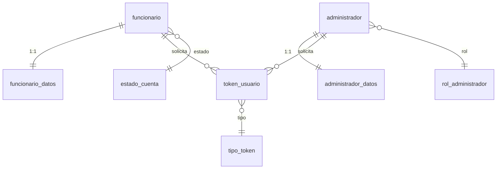
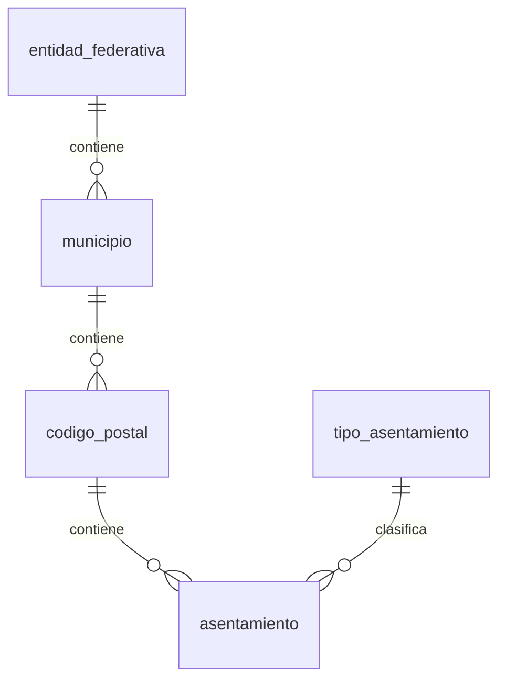
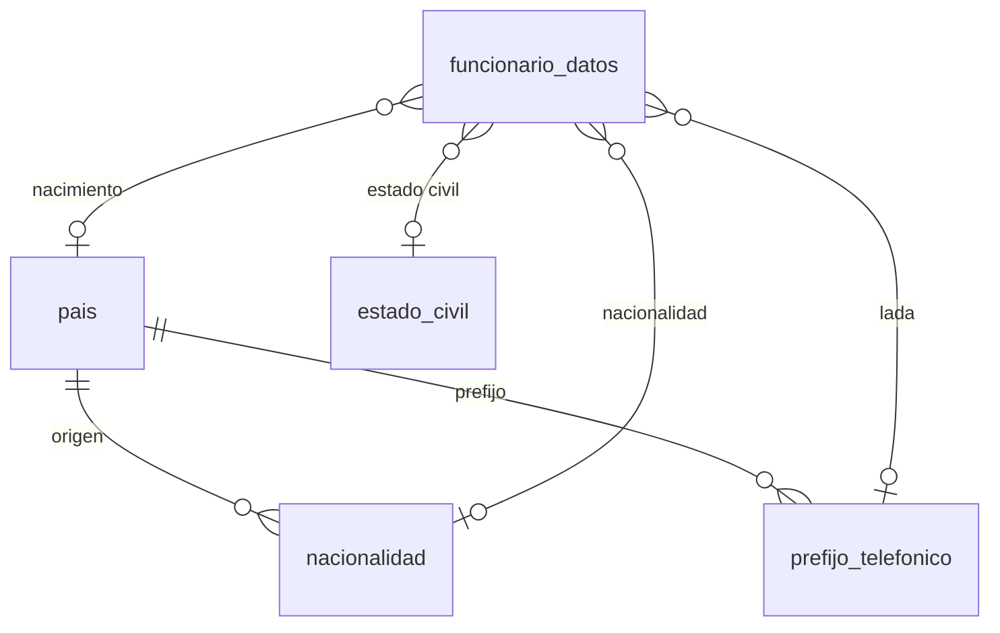

# Modelo relacional (ERD) — DeclaraNet UMSNH

Diagrama entidad-relación de la base de datos a la fecha de la migración
`0009_domicilio_declarante.sql`. Generado en Mermaid; se renderiza en GitHub y en la
mayoría de visores de Markdown.

> Nota: las declaraciones patrimoniales y sus anexos aún no se han modelado; este
> diagrama cubre usuarios, catálogos, domicilio y auditoría.

## Vista completa

```mermaid
erDiagram
    %% ========== USUARIOS ==========
    funcionario {
        bigint id PK
        dom_curp curp UK
        text password_hash
        smallint estado_cuenta_id FK
        timestamptz creado_en
        timestamptz actualizado_en
    }
    funcionario_datos {
        bigint funcionario_id PK_FK
        dom_rfc rfc UK
        text nombre_completo
        dom_correo correo UK
        dom_correo correo_secundario
        dom_telefono telefono
        dom_telefono telefono_casa
        dom_telefono telefono_celular
        smallint estado_civil_id FK
        smallint pais_nacimiento_id FK
        smallint nacionalidad_id FK
        smallint lada_celular_id FK
        timestamptz correo_verificado_en
        text token_sesion_hash
        timestamptz sesion_emitida_en
        timestamptz sesion_expira_en
        timestamptz creado_en
        timestamptz actualizado_en
    }
    administrador {
        bigint id PK
        citext nombre_usuario UK
        text password_hash
        smallint rol_id FK
        boolean activo
        timestamptz creado_en
        timestamptz actualizado_en
    }
    administrador_datos {
        bigint administrador_id PK_FK
        text nombre_completo
        dom_correo correo UK
        dom_correo correo_secundario
        dom_telefono telefono
        text token_sesion_hash
        timestamptz sesion_emitida_en
        timestamptz sesion_expira_en
        timestamptz creado_en
        timestamptz actualizado_en
    }
    token_usuario {
        bigint id PK
        smallint tipo_token_id FK
        bigint funcionario_id FK
        bigint administrador_id FK
        text token_hash UK
        timestamptz expira_en
        timestamptz usado_en
        inet ip_solicitud
        timestamptz creado_en
    }

    %% ========== CATÁLOGOS ==========
    estado_cuenta {
        smallint id PK
        text clave UK
        text descripcion
        boolean activo
    }
    rol_administrador {
        smallint id PK
        text clave UK
        text descripcion
        boolean activo
    }
    sexo {
        smallint id PK
        text clave UK
        text descripcion
        boolean activo
    }
    tipo_token {
        smallint id PK
        text clave UK
        text descripcion
        boolean activo
    }
    cargo {
        smallint id PK
        text clave UK
        text nombre
        smallint orden
        boolean activo
        text categoria
    }
    tipo_declaracion {
        smallint id PK
        text clave UK
        text descripcion
        boolean activo
    }
    estado_civil {
        smallint id PK
        text clave UK
        text nombre
        smallint orden
        boolean activo
    }
    pais {
        smallint id PK
        char iso2 UK
        char iso3 UK
        text nombre
        boolean activo
    }
    nacionalidad {
        smallint id PK
        smallint pais_id FK
        text nombre
        boolean activo
    }
    prefijo_telefonico {
        smallint id PK
        smallint pais_id FK
        text prefijo
        boolean principal
        boolean activo
    }
    entidad_federativa {
        smallint id PK
        text clave UK
        text nombre
        boolean activo
    }
    municipio {
        bigint id PK
        smallint entidad_federativa_id FK
        text clave
        text nombre
        boolean activo
    }
    tipo_asentamiento {
        smallint id PK
        text clave UK
        text nombre
        boolean activo
    }
    codigo_postal {
        bigint id PK
        bigint municipio_id FK
        text codigo
        boolean activo
    }
    asentamiento {
        bigint id PK
        bigint codigo_postal_id FK
        smallint tipo_asentamiento_id FK
        text nombre
        boolean activo
    }

    %% ========== DOMICILIO ==========
    domicilio {
        bigint id PK
        text tipo_domicilio
        text calle
        text numero_exterior
        text numero_interior
        text aclaraciones_observaciones
        smallint entidad_federativa_id FK
        bigint municipio_id FK
        text codigo_postal
        bigint colonia_id FK
        text ciudad
        text estado_region
        text codigo_postal_extranjero
        smallint pais_id FK
        timestamptz creado_en
        timestamptz actualizado_en
    }

    %% ========== AUDITORÍA ==========
    registro_evento {
        bigint id PK
        text esquema
        text tabla
        char operacion
        bigint registro_id
        jsonb datos_anteriores
        jsonb datos_nuevos
        text usuario_bd
        timestamptz ocurrido_en
    }

    %% ---------- Relaciones: usuarios ----------
    funcionario ||--|| funcionario_datos : "1:1 datos"
    funcionario }o--|| estado_cuenta : "estado de cuenta"
    administrador }o--|| rol_administrador : "rol"
    administrador ||--|| administrador_datos : "1:1 datos"
    funcionario ||--o{ token_usuario : solicita
    administrador ||--o{ token_usuario : solicita
    token_usuario }o--|| tipo_token : tipo

    %% ---------- Relaciones: funcionario_datos ----------
    funcionario_datos }o--o| estado_civil : "estado civil"
    funcionario_datos }o--o| pais : "país de nacimiento"
    funcionario_datos }o--o| nacionalidad : "nacionalidad"
    funcionario_datos }o--o| prefijo_telefonico : "lada celular"

    %% ---------- Relaciones: catálogos geográficos ----------
    municipio }o--|| entidad_federativa : pertenece
    codigo_postal }o--|| municipio : pertenece
    asentamiento }o--|| codigo_postal : pertenece
    asentamiento }o--o| tipo_asentamiento : tipo

    %% ---------- Relaciones: nacionalidad/prefijo ----------
    nacionalidad }o--|| pais : "país de origen"
    prefijo_telefonico }o--|| pais : "país"

    %% ---------- Relaciones: domicilio ----------
    domicilio }o--o| entidad_federativa : "México"
    domicilio }o--o| municipio : "México"
    domicilio }o--o| asentamiento : colonia
    domicilio }o--o| pais : "extranjero"
```

## Vistas por módulo

### Usuarios



### Catálogos geográficos



### Catálogos de persona



## Notas

- Las relaciones `}o--o|` indican FK nullable (0..1).
- `patrimonial.domicilio` se vinculará a la tabla `declaracion` cuando exista (FK
  `declaracion_id`), para conservar la instantánea del domicilio al momento de la
  presentación.
- Los catálogos geográficos de municipio, código postal y asentamiento se cargan desde
  fuentes oficiales (INEGI/SEPOMEX); ver `docs/carga-catalogos-domicilio.md`.
- Falta por modelar: declaraciones (5 trámites), anexos patrimoniales, nombramientos,
  dependencias, puestos y políticas RLS.
