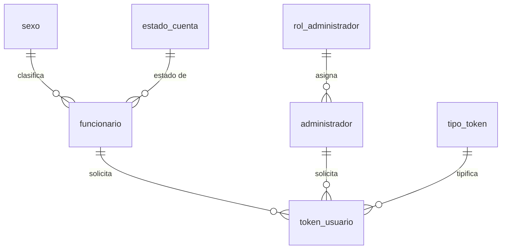

# Modelo conceptual

Estado: **sección de usuarios definida e implementada**; declaraciones y anexos en diseño.
Última actualización: 2026-11-11.

## 1. Actores

### Funcionario (usuario-funcionario)

Persona que labora o ha ocupado un cargo en la UMSNH. Puede:

- Crear su cuenta (con verificación de correo).
- Recuperar su contraseña.
- Crear declaraciones de los 5 tipos de trámite.
- Obtener su declaración y su acuse.

### Administrador (usuario-administrador)

Personal autorizado que opera la plataforma. Puede:

- Gestionar cuentas de funcionarios.
- Revisar y validar la información declarada.
- Generar reportes.
- Actualizar datos personales de funcionarios a solicitud.

Ambos tipos de usuario son **independientes**: tablas separadas, credenciales separadas
y tokens separados (aunque compartan el catálogo de tipos de token).

## 2. Entidades

### `patrimonial.funcionario`

| Atributo | Tipo | Regla |
|---|---|---|
| `id` | `bigint identity` | PK |
| `curp` | `dom_curp` | único, formato CURP |
| `rfc` | `dom_rfc` | único, RFC de persona física |
| `nombres`, `apellido_paterno`, `apellido_materno` | `dom_nombre` | apellido materno opcional |
| `fecha_nacimiento` | `date` | ≥ 1900-01-01 |
| `sexo_id` | FK `catalogos.sexo` | H / M |
| `correo` | `dom_correo` | único, sin distinguir mayúsculas |
| `telefono` | `dom_telefono` | 10 dígitos, opcional |
| `password_hash` | `text` | hash; mínimo 20 caracteres |
| `estado_cuenta_id` | FK `catalogos.estado_cuenta` | inicia en `PENDIENTE_VERIFICACION` |
| `correo_verificado_en` | `timestamptz` | al verificar el correo |
| `ultimo_acceso_en` | `timestamptz` | |
| `creado_en` / `actualizado_en` | `timestamptz` | `actualizado_en` por trigger |

### `seguridad.administrador`

| Atributo | Tipo | Regla |
|---|---|---|
| `id` | `bigint identity` | PK |
| `nombre_usuario` | `citext` | único, `^[a-z0-9._-]{3,50}$` |
| `correo` | `dom_correo` | único |
| `password_hash` | `text` | hash; mínimo 20 caracteres |
| `nombres`, `apellido_paterno`, `apellido_materno` | `dom_nombre` | |
| `rol_id` | FK `catalogos.rol_administrador` | |
| `activo` | `boolean` | baja lógica |
| `ultimo_acceso_en` | `timestamptz` | |
| `creado_en` / `actualizado_en` | `timestamptz` | |

### `seguridad.token_usuario`

Token de un solo uso para recuperación de contraseña o verificación de correo.

| Atributo | Regla |
|---|---|
| `tipo_token_id` | FK `catalogos.tipo_token` |
| `funcionario_id` / `administrador_id` | exactamente uno presente (`CHECK`) |
| `token_hash` | único, ≥ 32 caracteres; nunca se guarda el token en claro |
| `expira_en` | > `creado_en` |
| `usado_en` | marca de consumo (un solo uso) |
| `ip_solicitud` | `inet`, opcional |

## 3. Catálogos

| Catálogo | Valores |
|---|---|
| `tipo_declaracion` | `INICIO`, `MODIFICACION`, `CONCLUSION`, `NOTA_ACLARATORIA`, `CAMBIO_DEPENDENCIA` |
| `estado_cuenta` | `PENDIENTE_VERIFICACION`, `ACTIVA`, `BLOQUEADA`, `BAJA` |
| `rol_administrador` | `SUPERADMINISTRADOR`, `ADMINISTRADOR`, `REVISOR`, `CONSULTA` |
| `sexo` | `H`, `M` |
| `tipo_token` | `RECUPERACION_PASSWORD`, `VERIFICACION_CORREO` |

## 4. Relaciones

## 5. Reglas transversales

- Las contraseñas se guardan **solo como hash** (bcrypt/argon2id); la base rechaza valores
  de menos de 20 caracteres.
- Los tokens se guardan **solo como hash**, caducan y son de un solo uso.
- Toda alta, cambio o baja en `funcionario` y `administrador` se registra en
  `auditoria.registro_evento`, **sin** `password_hash` ni `token_hash`.
- El correo es único sin distinguir mayúsculas (`citext`).
- CURP y RFC son únicos y validados por dominio.
- Pendiente: nombramientos/dependencias, declaraciones y anexos patrimoniales.
